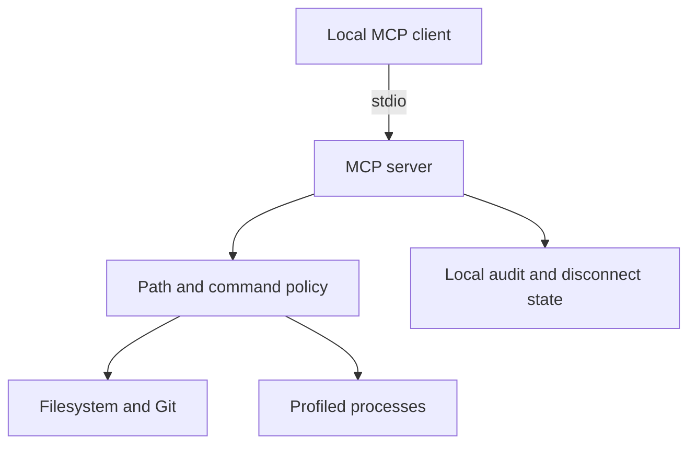
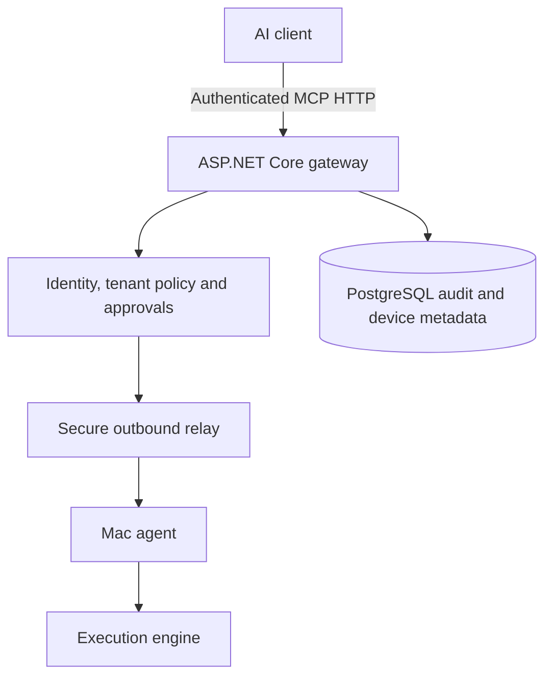

# Architecture: local first, relay later

## Delivered local slice

- `src/server.ts`: SDK protocol registration and structured results.
- `src/policy.ts`: canonical path authorization.
- `src/files.ts`: bounded filesystem tools and controlled edits.
- `src/commands.ts`: fixed-command process manager and read-only Git.
- `src/device.ts`: revocation and metadata-only local audit.
- `src/cli.ts`: user lifecycle and diagnostics.

The separation allows a future authenticated relay adapter to call the same local execution methods. It does **not** currently provide an abstract remote request router, multi-user identity, or capability tokens.

## Proposed SaaS architecture (not implemented)

The Mac must initiate its connection outbound (no port-forwarding). The gateway validates identity, workspace membership, tool scope, device ownership, expiration, and request identity **before** routing. A response must be associated with the same request ID, device, workspace and session. Disconnect and revocation invalidate outstanding work.

Initial prospective tables: users, workspaces, memberships, devices, device_permissions, device_sessions, tool_executions, approvals, audit_logs. Use row ownership checks and add cross-tenant tests before any SaaS release.

Future folders may include `apps/mcp-gateway`, `apps/dashboard`, `packages/execution-core`, `packages/tool-contracts`, and `packages/security-policy`. The current prototype deliberately keeps the executable small until the local path is proven on a real Mac.

No billing, subscriptions or production VPS deployment is in scope for M0–M2.
