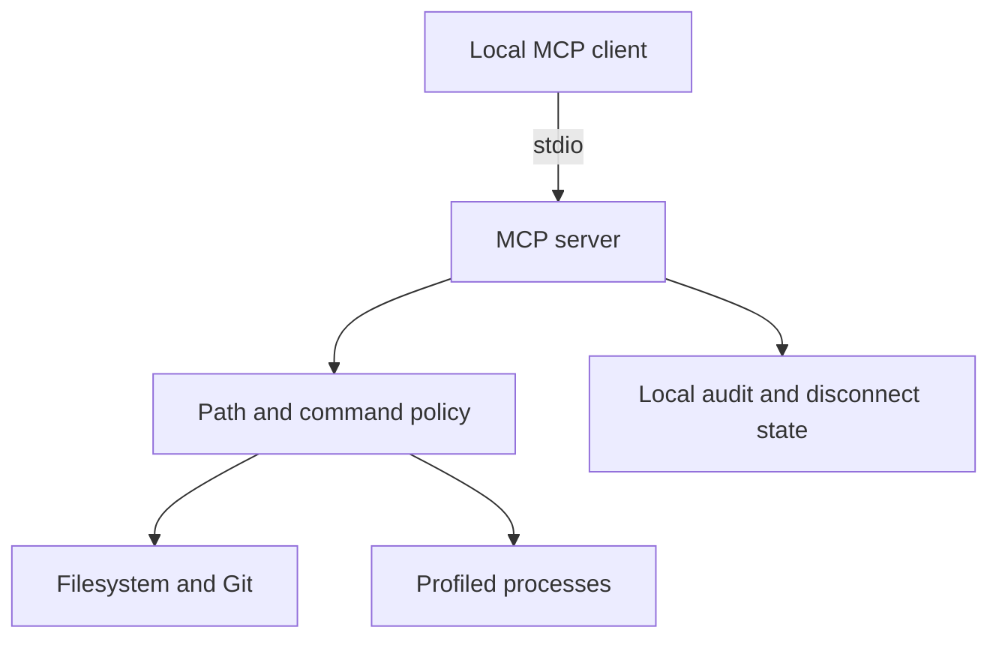
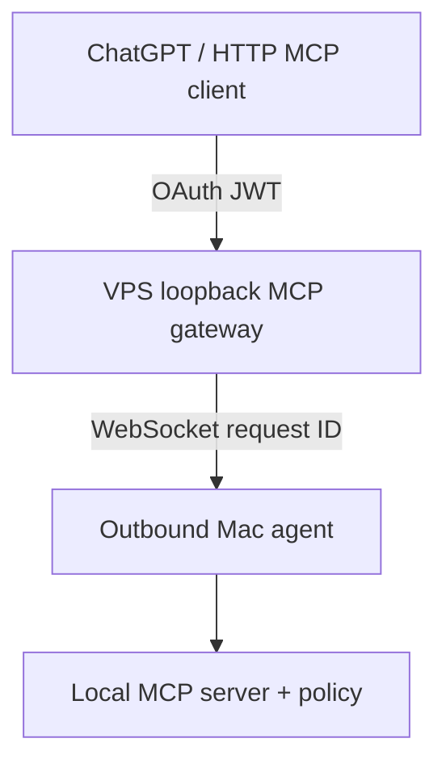
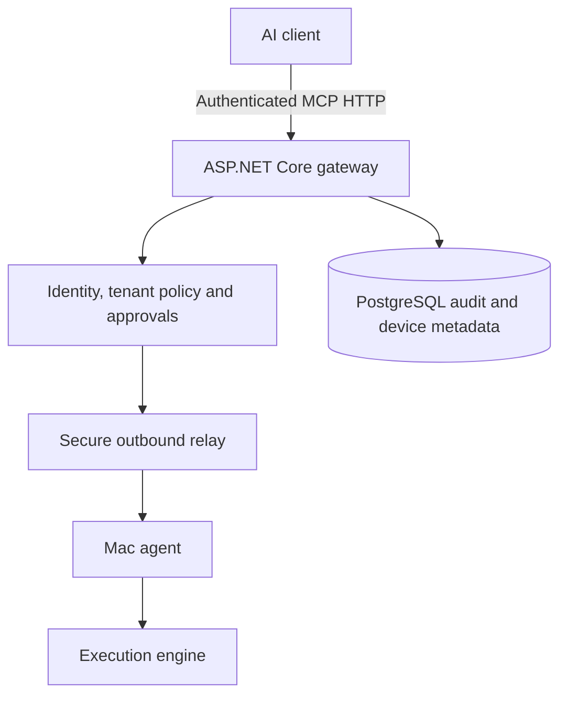

# Architecture: local agent and independent relay

## Delivered local slice

- `src/server.ts`: SDK protocol registration and structured results.
- `src/policy.ts`: canonical path authorization.
- `src/files.ts`: bounded filesystem tools and controlled edits.
- `src/commands.ts`: fixed-command process manager and read-only Git.
- `src/device.ts`: revocation and metadata-only local audit.
- `src/cli.ts`: user lifecycle and diagnostics.

## Experimental self-hosted relay (implemented in code; not deployed)

- `src/relay-server.ts` is a loopback-only MCP Streamable HTTP resource server. It verifies issuer, audience, signature, expiration, owner identity and scope using an external OAuth provider's JWKS. It does not implement or store OAuth user credentials.
- `src/relay-channel.ts` authenticates one outbound Mac WebSocket with a distinct device secret, caps frame size/concurrency, and correlates asynchronous tool calls and replies.
- `src/remote-agent.ts` connects outward, invokes the same local MCP server in memory and reconnects after disconnects.
- `src/proxy-server.ts` advertises the remote tool contract. It never touches VPS files or executes commands. Keep its tool names and schemas in sync with `src/server.ts` until a shared generated registry is introduced.

The local gateway currently handles a **single owner and one Mac**. Neither multi-user identity, device-scoped OAuth authorization, a secure pairing UI, per-invocation approval nor SaaS is implemented. See [relay setup and verification gates](remote-relay.md).

## Proposed SaaS architecture (not implemented)

The Mac must initiate its connection outbound (no port-forwarding). The gateway validates identity, workspace membership, tool scope, device ownership, expiration, and request identity **before** routing. A response must be associated with the same request ID, device, workspace and session. Disconnect and revocation invalidate outstanding work.

Initial prospective tables: users, workspaces, memberships, devices, device_permissions, device_sessions, tool_executions, approvals, audit_logs. Use row ownership checks and add cross-tenant tests before any SaaS release.

Future folders may include `apps/mcp-gateway`, `apps/dashboard`, `packages/execution-core`, `packages/tool-contracts`, and `packages/security-policy`. The current prototype deliberately keeps the executable small until the local path is proven on a real Mac.

No billing, subscriptions or production VPS deployment is in scope for M0–M2.
