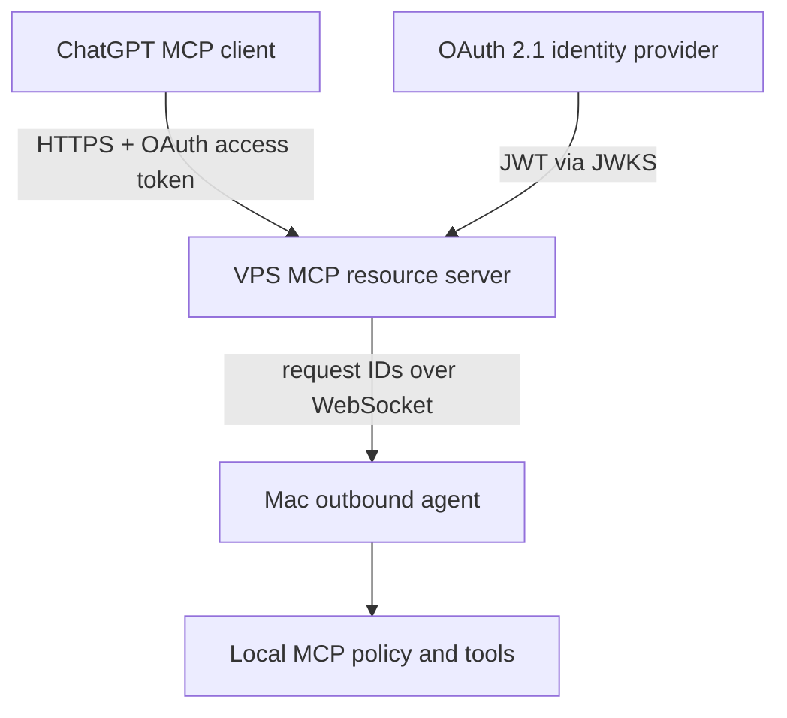

# Independent VPS relay (alpha, not deployed)

This is an **alternative to OpenAI Secure MCP Tunnel**, not a wrapper around OpenAI API usage. ChatGPT connects to a public HTTPS `/mcp` resource server. The Mac agent initiates an outbound authenticated `wss://` connection to the same relay. The VPS brokers individual tool calls and does not execute filesystem/terminal tools.

**Always-on behavior:** the gateway, OAuth verification, MCP tool discovery and health endpoint live on the VPS independently of the Mac. A browser or ChatGPT session **on the Mac** talks to the VPS just like any other client. When the Mac agent itself is offline, remote Mac filesystem and process calls return an explicit `Mac agent is offline` error; the VPS cannot access a powered-off Mac. VPS-hosted resources or future server-side tools would need a separate, tightly restricted executor. Never point the existing Mac filesystem tools at shared VPS production files.

## Current implementation

- Gateway: `node dist/cli.js relay` binds **only** to `127.0.0.1` or `::1`; no public listener. The external TLS terminator, DNS and OAuth provider must be provided separately.
- The proposed always-on service is [`deploy/systemd/remote-mcp-relay.service`](../deploy/systemd/remote-mcp-relay.service). It uses a dedicated non-root account, restarts on failures, caps memory/CPU/processes and is independent of `ci-runner`. It is **a reviewed candidate, not installed or enabled on production**.
- Proposed isolated Nginx vhosts: [`deploy/nginx/mcp.dualangka.com.bootstrap.conf.example`](../deploy/nginx/mcp.dualangka.com.bootstrap.conf.example) for HTTP-01 certificate bootstrap/renewal, and [`deploy/nginx/mcp.dualangka.com.conf.example`](../deploy/nginx/mcp.dualangka.com.conf.example) for HTTPS/WSS. Do not enable or reload either without review. The HTTPS certificate paths are placeholders until issuance.
- HTTP: `POST /mcp` uses the official MCP Streamable HTTP SDK. Requests require `Authorization: Bearer` with an access token whose JWT signature, `iss`, `aud`, `exp`, owner `sub`, and `mcp:tools` scope pass verification. A JWKS URL on the identity provider's origin is required. Failed checks return `401` and an RFC 9728 resource metadata challenge.
- Discovery: `GET /.well-known/oauth-protected-resource` advertises the resource, its OAuth issuer and scope. **The issuer must independently support authorization-code + PKCE S256 and ChatGPT-compatible CIMD, DCR, or predefined client configuration.** This relay intentionally does not implement its own authorization server.
- Mac: `node dist/cli.js agent` connects outbound using a 32+ byte random `RELAY_DEVICE_TOKEN`. Only one Mac connection is accepted at a time; requests carry random correlated IDs and enforce frame size, concurrency and timeout limits.
- Local policy: the 14 MCP tools retain the Mac's allowed roots, denylist, write-disabled default, exact terminal profiles and persistent revocation. In particular, `agent` does **not** open a Mac listening port.
- No GitHub Actions. The existing independently hosted VPS CI remains main-only and isolated from production.

## Prerequisites before any live deployment

1. Use a dedicated hostname with valid HTTPS and WSS certificates, e.g. `mcp.example.com`; keep the Node service on loopback behind the existing Nginx. Confirm the shared VPS has sufficient available disk, memory and CPU before adding a service.
2. Configure an established OAuth provider that supports ChatGPT's OAuth 2.1 contract (authorization code, PKCE S256, Client ID Metadata Document or DCR). The authorization server must issue JWT **access tokens** containing `aud: https://mcp.example.com`, the owner's exact `sub`, `exp` and scope `mcp:tools`. Make sure this is the **access token**, not an ID token. Configure the exact callback URI displayed in ChatGPT. Do not guess a redirect URI.
3. Generate a separate high-entropy device secret (e.g. `openssl rand -hex 32`). Store the same secret in restricted environment files on the Mac and VPS; **never** put it in the repository, screenshots, chat, URL query strings or shell history. Restrict files to mode `0600`. Rotate after compromise.
4. Review Nginx reverse proxy paths `/mcp`, `/.well-known/oauth-protected-resource`, `/agent/ws`, and optionally `/healthz`. Forward the original `Authorization` header on both `/mcp` and `/agent/ws`, and forward WebSocket `Upgrade`/`Connection` headers. Require public HTTPS; do not disclose sensitive headers in logs. Rate-limit and cap request bodies. Never publish the loopback Node listener directly.
5. Configure the Mac's allowed roots to a small, non-sensitive test directory; leave `allowWrites: false` and `commandProfiles: {}` until explicitly approved. Run the Mac agent as the standard non-admin account.

## Review-gated HTTPS certificate bootstrap

The shared VPS already runs Nginx for other sites. The new `mcp.dualangka.com` certificate does not exist yet. Do **not** use `certbot --nginx`, stop Nginx, or reload Nginx automatically.

1. After review, install the HTTP-only candidate at `deploy/nginx/mcp.dualangka.com.bootstrap.conf.example` for **this exact hostname** and create `/var/www/remote-mcp-acme` (root-owned, directory mode 0755). Keep `/mcp` and `/agent/ws` inaccessible over HTTP.
2. Run `sudo nginx -t` and **stop before reload** for explicit approval. A successful syntax test alone does not authorize a reload.
3. After bootstrap reload approval, verify a harmless challenge file is served under `http://mcp.dualangka.com/.well-known/acme-challenge/`. Obtain a certificate with `certbot certonly --webroot -w /var/www/remote-mcp-acme -d mcp.dualangka.com`; this does not need Certbot's Nginx auto-editor. Confirm automatic renewal is configured and the HTTP challenge vhost remains active.
4. Only when the certificate, OAuth issuer/JWKS and owner restrictions are verified, install the separate HTTPS/WSS Nginx candidate. Run `sudo nginx -t`, show the resulting diff and **stop before this second reload** for review. Do not run either reload without approval.
5. Test an unauthenticated `POST /mcp` returns `401` with `WWW-Authenticate`, while OAuth protected-resource metadata is readable over HTTPS. Exercise the real login flow and a non-sensitive Mac-only test directory; keep writes disabled by default.

## VPS environment variables

The relay reads these variables when starting:

| Variable | Purpose |
| --- | --- |
| `RELAY_PUBLIC_ORIGIN` | Exact public HTTPS origin, e.g. `https://mcp.example.com` (no path or trailing slash) |
| `RELAY_AUTH_ISSUER` | Exact OAuth authorization-server `issuer` URL |
| `RELAY_JWKS_URL` | HTTPS issuer-origin JWKS URL for JWT access-token verification |
| `RELAY_OWNER_SUB` | Exact OAuth subject allowed to invoke Mac tools |
| `RELAY_DEVICE_TOKEN` | Random private 32+ byte device secret; same on Mac |
| `RELAY_BIND` | `127.0.0.1` (default); public binding rejected |
| `RELAY_PORT` | `3417` (default) |

After installing Node.js 22+ dependencies, run `npm ci`, `npm run check`, `npm run build`, then `node dist/cli.js relay` as a separate restricted non-root service user. **Do not** run it as the CI runner or mount production application credentials. This is a setup guide; no production service or firewall changes are made by the repository.

## Mac environment variables

Set `REMOTE_MCP_RELAY_WS=wss://mcp.example.com/agent/ws` and the same private `RELAY_DEVICE_TOKEN`. Start `node dist/cli.js agent` after `remote-mcp init`, explicitly approving a test folder in the local config. The agent will retry with a short delay when the VPS connection drops. A private launchd service can be added after live verification; no service is installed automatically.

## Verification gates

- `npm run check`: automated real MCP HTTP client ⇄ local relay ⇄ WebSocket ⇄ local MCP server round-trip, plus anonymous denial, invalid device credentials, offline errors, disallowed path and disabled-write tests.
- `GET /.well-known/oauth-protected-resource`: exact public origin and issuer before adding ChatGPT.
- Real OAuth: verify the provider's metadata advertises `S256`, ChatGPT-compatible client registration/identity, exact `resource` audience and a working authorization-code redirect. This **cannot** be validated by the synthetic test verifier.
- Live link: create a custom ChatGPT MCP plugin using `https://mcp.example.com/mcp`, complete OAuth login, list tools, read only a harmless test file and confirm disconnect/revocation.
- Review resource impact and rollback on the shared VPS before enabling anything publicly.

## Costs and boundaries

This mode makes **no requests to the OpenAI Platform API** and requires **no OpenAI Platform API key or Secure MCP Tunnel**. It still requires hosting, HTTPS/domain, a compatible identity provider, and whatever ChatGPT account features are needed to connect a custom MCP plugin; those may have their own costs or limits. It is **not free by definition**, nor a hosted SaaS. Avoid exposing owner files to arbitrary internet clients.
