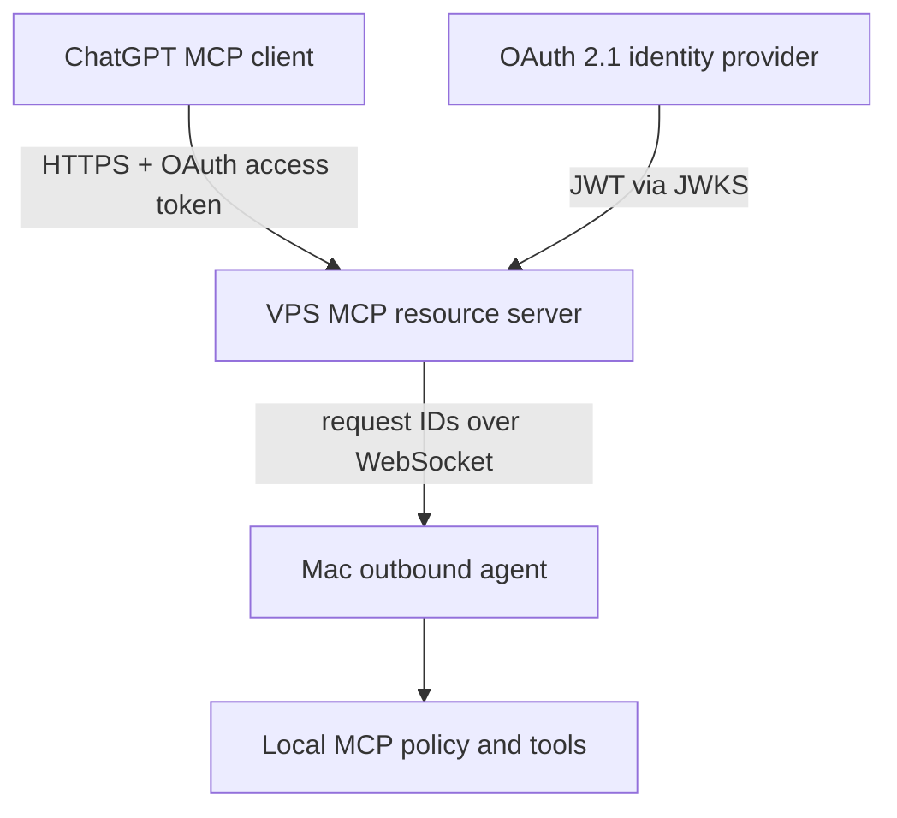

# Independent VPS relay (alpha)

This is an **alternative to OpenAI Secure MCP Tunnel**, not a wrapper around OpenAI API usage. ChatGPT connects to a public HTTPS `/mcp` resource server. The Mac agent initiates an outbound authenticated `wss://` connection to the same relay. The VPS brokers individual tool calls and does not execute filesystem/terminal tools.

An optional, owner-approved **iPhone Appium controller** runs on the Mac and adds ten bounded iPhone tools through this same relay. See [iPhone/Appium setup, protections, and one-time owner opt-in](iphone-appium.md). The VPS cannot control a physically disconnected or powered-off iPhone/Mac.

**Always-on behavior:** the gateway, OAuth verification, MCP tool discovery and health endpoint live on the VPS independently of the Mac. A browser or ChatGPT session **on the Mac** talks to the VPS just like any other client. When the Mac agent itself is offline, remote Mac filesystem and process calls return an explicit `Mac agent is offline` error; the VPS cannot access a powered-off Mac. VPS-hosted resources or future server-side tools would need a separate, tightly restricted executor. Never point the existing Mac filesystem tools at shared VPS production files.

The `vps_storage_audit` tool is the first **VPS-local, read-only** exception: it runs inside the existing unprivileged, always-on relay process, even when the Mac agent is offline. It never forwards VPS file paths to the Mac.



## Current implementation

- Gateway: `node dist/cli.js relay` binds **only** to `127.0.0.1` or `::1`; no public listener. The external TLS terminator, DNS and OAuth provider must be provided separately.
- The example always-on service is [`deploy/systemd/remote-mcp-relay.service`](../deploy/systemd/remote-mcp-relay.service). It uses a dedicated non-root account, restarts on failures, caps memory/CPU/processes and is independent of `ci-runner`. Review and adapt it before deployment.
- A proposed isolated Nginx vhost is [`deploy/nginx/mcp.dualangka.com.conf.example`](../deploy/nginx/mcp.dualangka.com.conf.example). Its certificate paths are placeholders; do not enable or reload it before valid DNS, certificates and OAuth.
- HTTP: `POST /mcp` uses the official MCP Streamable HTTP SDK. Requests require `Authorization: Bearer` with an access token whose JWT signature, `iss`, `aud`, `exp`, owner `sub`, and `mcp:tools` scope pass verification. A JWKS URL on the identity provider's origin is required. Failed checks return `401` and an RFC 9728 resource metadata challenge.
- Discovery: `GET /.well-known/oauth-protected-resource` advertises the resource, its OAuth issuer and scope. **The issuer must independently support authorization-code + PKCE S256 and ChatGPT-compatible CIMD, DCR, or predefined client configuration.** This relay intentionally does not implement its own authorization server.
- Mac: `node dist/cli.js agent` connects outbound using a 32+ byte random `RELAY_DEVICE_TOKEN`. Only one Mac connection is accepted at a time; requests carry random correlated IDs and enforce frame size, concurrency and timeout limits.
- Local policy: all Mac operations retain the Mac's allowed roots, denylist, write-disabled default, exact terminal profiles and persistent revocation. In particular, `agent` does **not** open a Mac listening port.
- No GitHub Actions. The existing independently hosted VPS CI remains main-only and isolated from production.

## Prerequisites before any live deployment

1. Use a dedicated hostname with valid HTTPS and WSS certificates, e.g. `mcp.example.com`; keep the Node service on loopback behind the existing Nginx. Confirm the shared VPS has sufficient available disk, memory and CPU before adding a service.
2. Configure an established OAuth provider that supports ChatGPT's OAuth 2.1 contract (authorization code, PKCE S256, Client ID Metadata Document or DCR). The authorization server must issue JWT **access tokens** containing `aud: https://mcp.example.com`, the owner's exact `sub`, `exp` and scope `mcp:tools`. Make sure this is the **access token**, not an ID token. Configure the exact callback URI displayed in ChatGPT. Do not guess a redirect URI.
3. Generate a separate high-entropy device secret (e.g. `openssl rand -hex 32`). Store the same secret in restricted environment files on the Mac and VPS; **never** put it in the repository, screenshots, chat, URL query strings or shell history. Restrict files to mode `0600`. Rotate after compromise.
4. Review Nginx reverse proxy paths `/mcp`, `/.well-known/oauth-protected-resource`, `/agent/ws`, and optionally `/healthz`. Forward the original `Authorization` header on both `/mcp` and `/agent/ws`, and forward WebSocket `Upgrade`/`Connection` headers. Require public HTTPS; do not disclose sensitive headers in logs. Rate-limit and cap request bodies. Never publish the loopback Node listener directly.
5. Configure the Mac's allowed roots to a small, non-sensitive test directory; leave `allowWrites: false` and `commandProfiles: {}` until explicitly approved. Run the Mac agent as the standard non-admin account.

## Optional file edits and system controls

These capabilities are installed but **disabled for destructive actions by default**. The Mac owner enables them by editing the local `~/.config/remote-mcp/config.json` (mode `0600`). A remote caller cannot expand these permissions.

- `fs_apply_patch`: set `allowWrites: true` to replace exactly one expected text occurrence **only inside allowedRoots**. Supply `expectedSha256` from a fresh `fs_read` to reject stale edits. No arbitrary file creation, deletion, or traversal outside allowed roots.
- `process_list` and `process_info`: inspect current-user processes without command-line arguments, capped at 100 entries per listing.
- `process_stop`: send graceful SIGTERM to a current-user process only if its exact executable **basename** is in `processStopAllowlist`; PID and `expectedStartedAt` must match the latest observation. Cannot stop the agent itself or protected low PIDs. No SIGKILL.
- `system_status`: inspect OS uptime, CPU load, memory and disk availability for the first approved root.
- `system_app_open`: launch an exact .app bundle under a locally configured alias in `appLaunchProfiles`. No shell and no arbitrary command arguments.
- `system_service_status` / `system_service_restart`: inspect or restart an explicitly allowlisted **current-user** launchd label. Never manages system/root daemons, and the MCP agent cannot restart itself.

Example of narrow opt-ins (substitute only local, trusted target names):

```json
{
  "allowedRoots": ["/Users/YOUR_NAME/Projects/mcp-sandbox"],
  "allowWrites": true,
  "processStopAllowlist": ["sleep"],
  "appLaunchProfiles": {
    "textedit": "/System/Applications/TextEdit.app"
  },
  "serviceRestartAllowlist": [],
  "commandProfiles": {}
}
```

Avoid allowing critical apps or broad process names like `node` without reviewing every matching user process. Changes to the Mac configuration require an agent restart. This is intentionally **not unrestricted Desktop Commander parity**: shell access, global filesystem access, arbitrary system shutdown/reboot, and privileged service control are excluded.

## Read-only VPS storage inventory

`vps_storage_audit` takes **no arguments**, uses the existing owner-bound `mcp:tools` OAuth authorization, and reads root filesystem capacity plus a bounded directory sample: `/var/cache/apt/archives`, `/var/log`, `/opt`, `/srv`, and `/var/www`. Each `du` call has a two-second timeout, runs sequentially, stays on one filesystem and does not follow directory symlinks. Read-only Docker disk summary and journal usage probes have three-second timeouts.

The relay remains the non-root `remote-mcp` service with systemd filesystem protections. Protected paths and the Docker socket may be inaccessible; the report marks them unavailable rather than silently inventing sizes. Reports are cached for 60 seconds to prevent repeated expensive walks. Subprocesses receive a minimal environment without relay credentials. No sudo, shell, delete, prune, or writable filesystem tool is provided on the VPS.

Any cleanup suggestions are **review-only candidates**, not permission to remove data. A full root-owned Docker or journal audit requires a separately approved privileged collector; do not weaken the relay service to grant broad access.

## VPS environment variables

The relay reads these variables when starting:

| Variable | Purpose |
| --- | --- |
| `RELAY_PUBLIC_ORIGIN` | Exact public HTTPS origin, e.g. `https://mcp.example.com` (no path or trailing slash) |
| `RELAY_AUTH_ISSUER` | Exact OAuth authorization-server `issuer` URL |
| `RELAY_JWKS_URL` | HTTPS issuer-origin JWKS URL for JWT access-token verification |
| `RELAY_OWNER_SUB` | Exact OAuth subject allowed to invoke Mac tools |
| `RELAY_DEVICE_TOKEN` | Random private 32+ byte device secret; same on Mac |
| `RELAY_BIND` | `127.0.0.1` (default); public binding rejected |
| `RELAY_PORT` | `3417` (default) |

After installing Node.js 22+ dependencies, run `npm ci`, `npm run check`, `npm run build`, then `node dist/cli.js relay` as a separate restricted non-root service user. **Do not** run it as the CI runner or mount production application credentials. This is a setup guide; no production service or firewall changes are made by the repository.

## Mac environment variables

Set `REMOTE_MCP_RELAY_WS=wss://mcp.example.com/agent/ws` and the same private `RELAY_DEVICE_TOKEN`. Start `node dist/cli.js agent` after `remote-mcp init`, explicitly approving a test folder in the local config. The agent will retry with a short delay when the VPS connection drops. A private launchd service can be added after live verification; no service is installed automatically.

## Verification gates

- `npm run check`: automated real MCP HTTP client ⇄ local relay ⇄ WebSocket ⇄ local MCP server round-trip, plus anonymous denial, invalid device credentials, offline errors, disallowed path and disabled-write tests.
- `GET /.well-known/oauth-protected-resource`: exact public origin and issuer before adding ChatGPT.
- Real OAuth: verify the provider's metadata advertises `S256`, ChatGPT-compatible client registration/identity, exact `resource` audience and a working authorization-code redirect. This **cannot** be validated by the synthetic test verifier.
- Live link: create a custom ChatGPT MCP plugin using `https://mcp.example.com/mcp`, complete OAuth login, list tools, read only a harmless test file and confirm disconnect/revocation.
- Review resource impact and rollback on the shared VPS before enabling anything publicly.

## Costs and boundaries

This mode makes **no requests to the OpenAI Platform API** and requires **no OpenAI Platform API key or Secure MCP Tunnel**. It still requires hosting, HTTPS/domain, a compatible identity provider, and whatever ChatGPT account features are needed to connect a custom MCP plugin; those may have their own costs or limits. It is **not free by definition**, nor a hosted SaaS. Avoid exposing owner files to arbitrary internet clients.
